# 🎯 DVWA Attack & Detection Lab

Lab offensif/défensif : des attaques web réelles (injection SQL, XSS, brute
force, injection de commandes) sont menées depuis Kali contre une application
volontairement vulnérable (DVWA) hébergée en DMZ, puis détectées par Suricata
et corrélées dans Wazuh. L'objectif est de documenter le cycle complet
**attaque → détection → analyse**, sur l'infrastructure pfSense déjà
segmentée du lab précédent.

➡️ Ce lab s'appuie sur [`pfsense-suricata-lab`](https://github.com/alexbzz/network-security-lab)
et [`wazuh-siem-lab`](https://github.com/alexbzz/wazuh-siem-lab), qui détaillent la mise en
place de la segmentation réseau, de Suricata et du SIEM.

## 🎯 Objectif

Déployer DVWA en DMZ, mener plusieurs classes d'attaques web depuis Kali,
vérifier leur détection par Suricata, suivre leur corrélation dans Wazuh, et
documenter chaque scénario avec son trafic, son alerte et son analyse.

## 🧰 Technologies

| Outil | Rôle |
|-------|------|
| DVWA | Application web volontairement vulnérable, cible des attaques |
| Kali Linux | Machine d'attaque (navigateur, sqlmap, hydra) |
| pfSense | Pare-feu / routeur, segmentation LAN / DMZ |
| Suricata | IDS, détection des attaques web |
| Wazuh | SIEM, corrélation et analyse des alertes |
| Debian | Serveur hébergeant DVWA (Apache, MariaDB, PHP) |
| VMware Workstation | Virtualisation |

## 🗺️ Architecture

```
            Internet
                |
             pfSense
                |
        -----------------
        |               |
       LAN             DMZ
        |               |
      Kali         Debian + DVWA
   (attaquant)      (cible vulnérable)
```

| Zone | Réseau | Machine | Rôle |
|------|--------|---------|------|
| LAN | 192.168.1.0/24 | Kali Linux | Attaquant |
| LAN | 192.168.1.0/24 | Serveur Wazuh | SIEM, corrélation |
| DMZ | 192.168.2.0/24 | Debian + DVWA | Cible vulnérable |

## ⚙️ Mise en place

### 1. Installation de DVWA
Installation d'Apache, MariaDB et PHP sur la Debian en DMZ, DVWA cloné depuis
GitHub, fichier `config/config.inc.php` renseigné (utilisateur dédié `dvwa`,
mot de passe propre à l'utilisateur SQL — pas de compte root applicatif), et
base de données initialisée via `setup.php`.


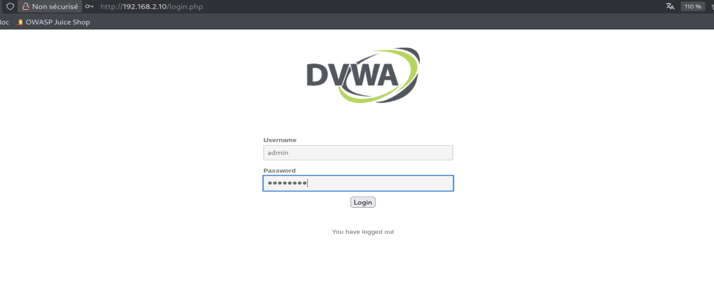

### 2. Configuration du niveau de sécurité
Niveau réglé sur **Low** pour les premiers scénarios, avant de durcir
progressivement (Medium, High) pour comparer la détection.

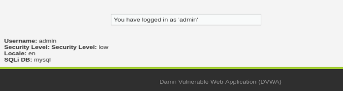

## 🎯 Scénarios d'attaque

### 3. Injection SQL
Extraction de données via une requête SQL manipulée dans le champ de
recherche utilisateur de DVWA (`User ID`).

**Attaque** : soumission du payload `1' OR '1'='1` à la place d'un ID
numérique. La clause `WHERE user_id = '...'` devient toujours vraie, ce qui
fait remonter l'ensemble des utilisateurs de la base en une seule requête, au
lieu d'un seul enregistrement.

**Détection** : les catégories ET Open par défaut (`emerging-sql`,
`emerging-web_specific_apps`), bien qu'activées sur l'interface LAN de
Suricata, n'ont déclenché aucune alerte sur ce payload — les signatures
génériques ciblent des patterns plus complexes (`UNION SELECT`,
`information_schema`, CMS connus) qui ne couvrent pas une injection aussi
simple sur un champ GET basique de DVWA. Une **règle Suricata personnalisée**
a donc été écrite pour détecter ce pattern précis :

```
alert http any any -> any any (msg:"CUSTOM SQLi - OR 1=1 pattern detected"; flow:to_server,established; http.uri; content:"OR"; nocase; content:"1'='1"; nocase; distance:0; classtype:web-application-attack; sid:9000001; rev:1;)
```

Après ajout de cette règle sur l'interface LAN et redémarrage de l'instance
Suricata, l'attaque rejouée a bien déclenché l'alerte `CUSTOM SQLi - OR 1=1
pattern detected` (source `192.168.1.103`, destination `192.168.2.10:80`).

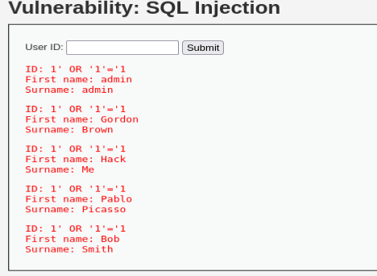
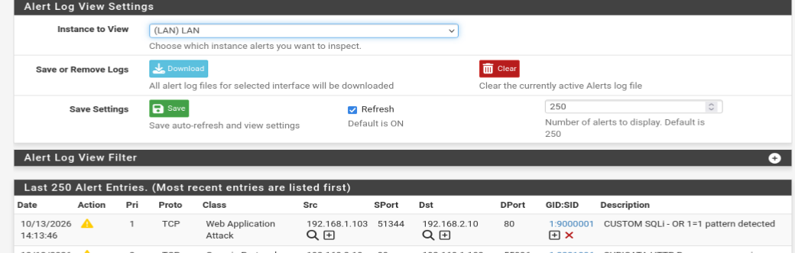
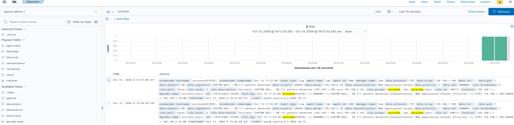
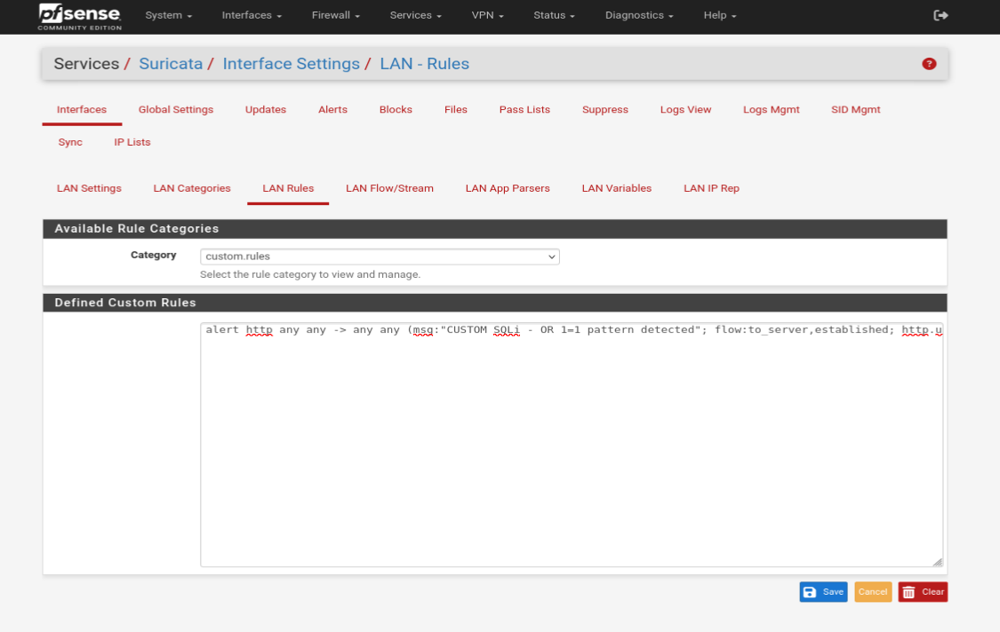

### 4. Brute force
Attaque par dictionnaire sur le formulaire de connexion DVWA avec Hydra.

**Attaque** : récupération d'un `PHPSESSID` valide (avec `security=low`),
puis lancement de Hydra contre `/vulnerabilities/brute/` avec le login fixe
`admin` et le dictionnaire `rockyou.txt` :

```
hydra -l admin -P /usr/share/wordlists/rockyou.txt 192.168.2.10 http-get-form "/vulnerabilities/brute/:username=^USER^&password=^PASS^&Login=Login:H=Cookie: PHPSESSID=<session>; security=low:F=Username and/or password incorrect."
```

Le mot de passe `password` a été trouvé en quelques secondes (`admin` /
`password`, l'un des comptes par défaut de DVWA). La rapidité s'explique par
l'absence totale de limitation de tentatives au niveau **Low** (pas de
délai, pas de blocage après échecs répétés), ce qui laisse Hydra enchaîner
des centaines de requêtes par seconde.

**Détection** : comme pour l'injection SQL, les règles ET Open par défaut
n'ont rien détecté — un brute force se caractérise par un **volume de
requêtes répétées** vers la même URL plutôt que par un contenu malveillant
dans une seule requête, ce que les signatures génériques ne couvrent pas
sans règle de seuil dédiée. Une **règle Suricata personnalisée avec
`threshold`** a donc été écrite :

```
alert http any any -> any any (msg:"CUSTOM Brute Force - Multiple login attempts on DVWA"; flow:to_server,established; http.uri; content:"/vulnerabilities/brute/"; nocase; threshold:type threshold, track by_src, count 10, seconds 5; classtype:web-application-attack; sid:9000002; rev:1;)
```

Cette règle ne déclenche une alerte que si la **même source** envoie **10
requêtes ou plus en 5 secondes** vers l'URL de brute force, ce qui évite le
bruit sur du trafic normal et ne réagit qu'à un vrai pattern d'attaque.
Après ajout de la règle et redémarrage de l'instance Suricata sur LAN,
l'attaque rejouée a déclenché plusieurs alertes `CUSTOM Brute Force -
Multiple login attempts on DVWA`, correctement corrélées dans Wazuh (source
`192.168.1.103`, destination `192.168.2.10:80`, classification "Web
Application Attack").

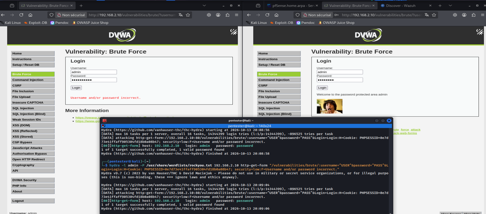
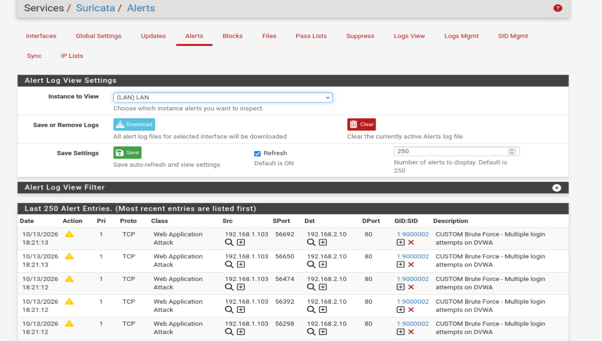
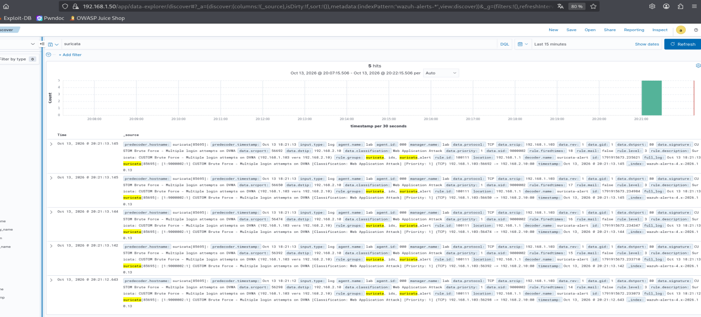


### 5. Cross-Site Scripting (XSS)
*(à faire)* Injection d'un script dans un champ non filtré, exécuté côté
client.

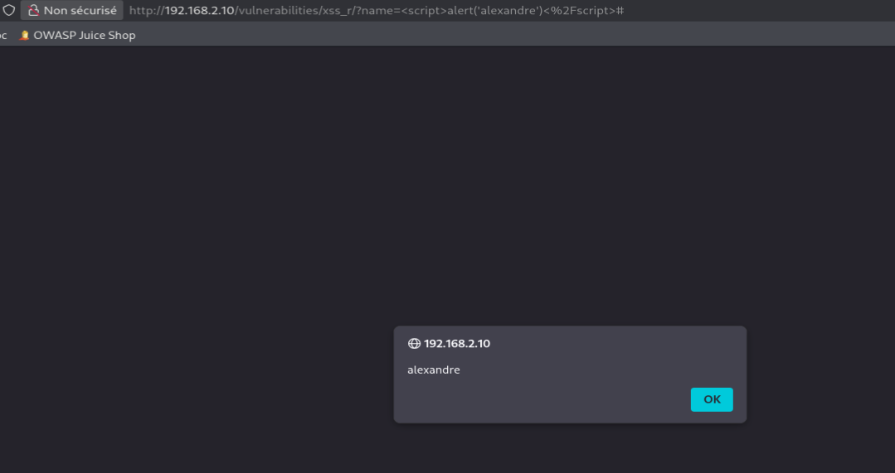
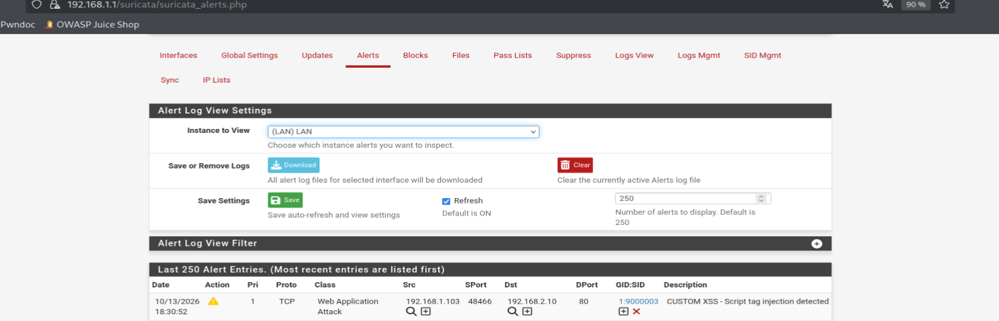
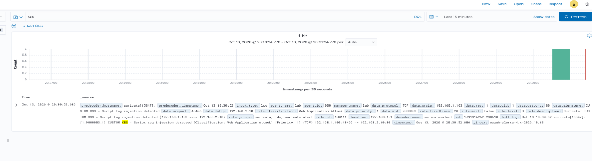

### 6. Injection de commandes
*(à faire)* Exécution de commandes système via le module Command Injection
de DVWA.

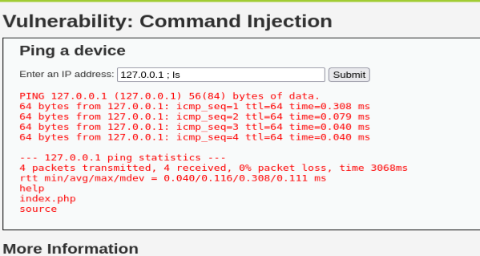
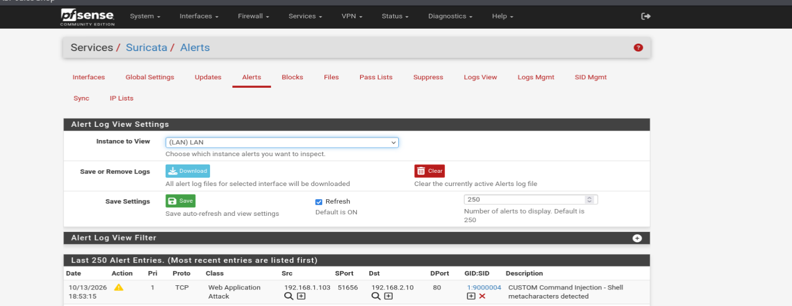
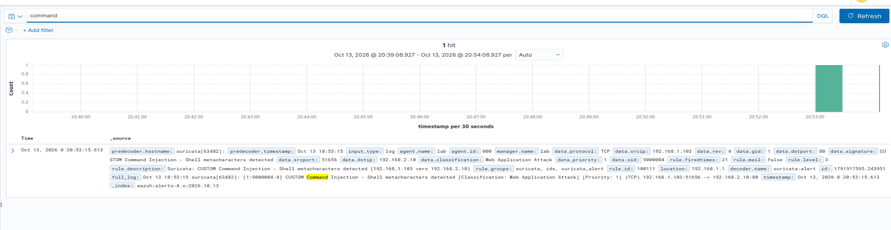

## 🔬 Comparaison par niveau de sécurité

Même attaque (SQLi) rejouée sur les trois niveaux DVWA, pour illustrer
l'effet des protections applicatives sur la détection réseau.

| Niveau | Attaque réussie | Détectée par Suricata |
|--------|------------------|------------------------|
| Low | ✅ | ✅ (règle custom) |
| Medium | ⬜ | ⬜ |
| High | ⬜ | ⬜ |


## ✅ Tests et résultats

| Test | Attendu | Résultat |
|------|---------|----------|
| SQL Injection détectée | Alerte Suricata + Wazuh | ✅ (via règle custom) |
| Brute force détecté | Alerte Suricata + Wazuh | ✅ (via règle custom) |
| XSS détecté | Alerte Suricata + Wazuh | ⬜ |
| Command Injection détectée | Alerte Suricata + Wazuh | ⬜ |
| Corrélation complète dans Wazuh | Source, IP attaquante, signature visibles | ⬜ |

## 🧩 Difficultés rencontrées

- **Interface WireGuard résiduelle sur Kali (`kali`, 10.2.0.2/32)** : une
  interface VPN WireGuard restée active (sans process visible dans `ps aux`)
  forçait tout le trafic sortant de Kali à passer par le tunnel au lieu de
  l'interface `eth0` du LAN. Le ping et le curl vers la DMZ échouaient tous
  les deux en timeout silencieux, sans erreur explicite, alors que la route
  par défaut (`ip route`) semblait correcte. Diagnostic confirmé via
  `curl -v` (adresse source `10.2.0.2` au lieu de `192.168.1.103`) et `ip
  addr`. Résolu en supprimant l'interface (`ip link delete kali`) et le
  fichier de configuration associé (`/etc/wireguard/kali.conf`).
- **Erreur de syntaxe SQL lors de la création de l'utilisateur `dvwa`** :
  `ERROR 1064` suivi d'un `ERROR 1396 (Operation CREATE USER failed)` — un
  utilisateur du même nom existait déjà d'une tentative précédente. Résolu
  avec `DROP USER IF EXISTS` avant de recréer l'utilisateur.
- **Règles Suricata par défaut insuffisantes pour l'injection SQL** :
  `emerging-sql.rules` et `emerging-web_specific_apps.rules` étaient
  activées mais ne couvraient pas un payload aussi simple que
  `' OR '1'='1`. Écriture d'une règle personnalisée (voir scénario 3).
- **Aucune détection par défaut du brute force** : même constat que pour le
  SQLi — les règles ET Open ne couvrent pas un volume de requêtes répétées
  vers une même URL. Nécessité d'une règle personnalisée avec `threshold`
  pour ne déclencher qu'au-delà d'un nombre de tentatives sur une fenêtre de
  temps donnée (voir scénario 4).

## 📚 Ce que j'ai appris

- Mise en œuvre d'attaques web classiques (OWASP Top 10) en environnement
  contrôlé
- Détection réseau d'attaques applicatives avec Suricata
- Corrélation d'alertes multi-sources dans un SIEM
- Effet du durcissement applicatif sur la détectabilité d'une attaque
- Les signatures IDS génériques (ET Open) ne couvrent pas tous les cas :
  écrire des règles personnalisées est parfois nécessaire pour des patterns
  d'attaque simples mais spécifiques
- Diagnostiquer un problème réseau méthodiquement, couche par couche
  (ARP, routage, pare-feu, capture de paquets) pour isoler la véritable
  cause d'une perte de connectivité

## 🚀 Pistes d'amélioration

- Automatiser les scénarios avec des scripts (reproductibilité)
- Ajouter d'autres règles Suricata personnalisées pour les attaques non
  détectées par défaut (brute force, XSS, command injection)
- Comparer plusieurs outils d'attaque (sqlmap, Burp Suite, OWASP ZAP)
- Documenter les faux positifs / faux négatifs rencontrés

## 📁 Structure du dépôt

```
.
├── README.md
├── screenshots/
├── configs/        # exports de config (sans données sensibles)
└── docs/           # notes détaillées
```

## ⚠️ Avertissement

Ce lab est réalisé à des fins pédagogiques, dans un environnement isolé. DVWA
est une application volontairement vulnérable : elle ne doit jamais être
exposée sur un réseau non contrôlé ou accessible depuis Internet.
